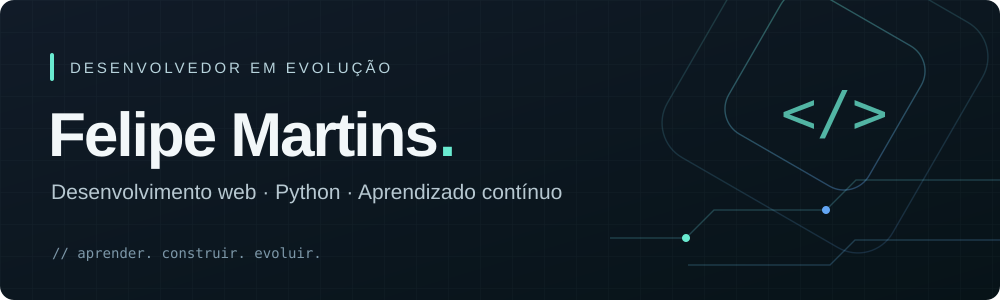
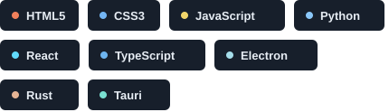
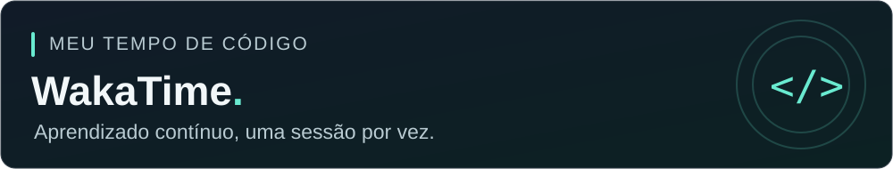

  <picture>
    <source media="(max-width: 600px)" srcset="assets/profile-banner-mobile.svg" />
    
  </picture>

<h3 align="center">Ideias em código. Projetos na prática.</h3>

  Sou <strong>Felipe Martins de Oliveira</strong>. Estudo desenvolvimento e coloco o aprendizado em prática criando interfaces web e aplicações para desktop. Meu objetivo é evoluir como desenvolvedor full stack.

  <a href="https://www.linkedin.com/in/felipe-martins-de-oliveira-81756a306/">LinkedIn ↗</a>
  &nbsp; · &nbsp;
  <a href="https://github.com/Felipe-Martins-De-Olveira?tab=repositories">Meus repositórios ↗</a>

## Tecnologias que uso

  <picture>
    <source media="(max-width: 600px)" srcset="assets/technologies-mobile.svg" />
    
  </picture>

## Em desenvolvimento

> **Otimizador de PC**
>
> Estou desenvolvendo um software para otimizar o computador, usando **Rust e Tauri**.
> O repositório será publicado em breve.

## Projetos em destaque

| Projeto | O que explorei |
| :--- | :--- |
| [**PawShop**](https://github.com/Felipe-Martins-De-Olveira/PawShop2) | Interface web para o universo pet, com layouts responsivos e alternância de tema. **HTML · CSS · JavaScript · Bootstrap** |
| [**CalcPy**](https://github.com/Felipe-Martins-De-Olveira/Calculadora-com-Interface-Gr-fica-em-Python) | Calculadora com interface gráfica, eventos de teclado e operações matemáticas. **Python · Tkinter** |
| [**Página de login**](https://github.com/Felipe-Martins-De-Olveira/PaginLogin) | Interfaces de login e cadastro para praticar a construção de formulários. **HTML · CSS** |

## Estatísticas GitHub

  <picture>
    <source media="(prefers-color-scheme: dark)" srcset="https://github-readme-stats.vercel.app/api?username=Felipe-Martins-De-Olveira&amp;include_all_commits=false&amp;count_private=false&amp;show_icons=true&amp;hide_border=false&amp;border_radius=12&amp;card_width=495&amp;locale=pt-br&amp;custom_title=Felipe+Martins+%7C+GitHub&amp;disable_animations=true&amp;bg_color=111b28&amp;title_color=69ead0&amp;text_color=c6d4e1&amp;icon_color=69ead0&amp;ring_color=69ead0&amp;border_color=30363d" />
    
  </picture>

  <picture>
    <source media="(prefers-color-scheme: dark)" srcset="https://streak-stats.demolab.com/?user=Felipe-Martins-De-Olveira&amp;locale=pt_BR&amp;mode=daily&amp;card_width=495&amp;border_radius=12&amp;hide_border=false&amp;disable_animations=true&amp;background=111b28&amp;border=30363d&amp;stroke=303c46&amp;ring=69ead0&amp;fire=69ead0&amp;currStreakNum=e6edf3&amp;sideNums=e6edf3&amp;currStreakLabel=69ead0&amp;sideLabels=c6d4e1&amp;dates=9ba6b2" />
    
  </picture>

## Meu tempo de código

  <a href="https://wakatime.com/@018eaf41-4fc0-4335-abcd-dcadcfcd4363">
    <picture>
      <source media="(max-width: 600px)" srcset="assets/wakatime-banner-mobile.svg" />
      
    </picture>
  </a>

Linguagens ao longo de todo o meu histórico registrado no WakaTime.

  <a href="https://wakatime.com/@018eaf41-4fc0-4335-abcd-dcadcfcd4363">
  <picture>
    <source media="(prefers-color-scheme: dark)" srcset="https://wakatime.com/share/@018eaf41-4fc0-4335-abcd-dcadcfcd4363/53eb4b10-67b3-4552-ad06-449e7aa9c752.png" />
    
  </picture>
  </a>

## Aprendizado contínuo

Gosto de estudar pelas documentações oficiais e por conteúdos na internet, colocando em prática o que aprendo nos meus projetos.

  
<strong>Cursos e certificados</strong>

   

  - [Desenvolvedor front-end](https://github.com/user-attachments/files/16324900/Imagem.24.pdf)
  - [Soft Skills](https://github.com/Felipe-Martins-De-Olveira/Felipe-Martins-De-Olveira/files/15111931/SoftSkills.pdf)
  - [Despertando a Criatividade e a Inovação](https://github.com/Felipe-Martins-De-Olveira/Felipe-Martins-De-Olveira/files/15111935/Despertando.a.Criatividade.e.a.Inovacao.pdf)
  - [Elevação Sustentável: Domínio do ESG para um Futuro Responsável](https://github.com/Felipe-Martins-De-Olveira/Felipe-Martins-De-Olveira/files/15111939/Elevacao.Sustentavel.Dominio.do.ESG.para.um.Futuro.Responsavel.pdf)
  - [Desafios Complexos e Liderança Impactante](https://github.com/Felipe-Martins-De-Olveira/Felipe-Martins-De-Olveira/files/15111943/Desafios.Complexos.e.Lideranca.Impactante.pdf)

---

Aprendendo, construindo e melhorando a cada projeto.

